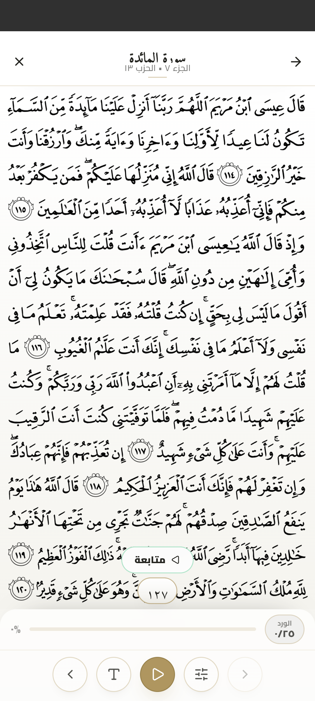

# WARDI

[](https://github.com/amr-2155/wardi/actions/workflows/ci.yml)
[](https://github.com/amr-2155/wardi/releases/latest)

**Wardi** is an offline-first Quran reading tracker for Android and the web. It
combines a daily ward planner, a full-screen Mushaf reader, prayer times,
reminders, tafsir, adhkar and progress history in one Arabic/English app built
from a single Next.js + Capacitor codebase.

The app does not require an account or a backend. Everything a reader creates
stays in local storage, and backups are explicit files the reader controls.

**Repository:** <https://github.com/amr-2155/wardi><br>
**Latest release:** [v1.1.2](https://github.com/amr-2155/wardi/releases/tag/v1.1.2)<br>
**Latest CI run:** [verify on `main`](https://github.com/amr-2155/wardi/actions/workflows/ci.yml)

---

## Contents

- [Project overview](#project-overview)
- [Main features](#main-features)
- [Screenshots](#screenshots)
- [Installation](#installation)
- [Version information](#version-information)
- [Technologies used](#technologies-used)
- [Development](#development)
- [Verification](#verification)
- [Architecture and data](#architecture-and-data)
- [Known limitations](#known-limitations)

---

## Project overview

Wardi helps a reader keep a consistent daily portion of the Quran. A ward is
defined as a page range, and progress is earned only when those pages are
actually read or finished — opening a plan, or merely landing on its final
page, never marks it complete. The same ward state drives Home, Plan, Stats,
History and Khatma views.

The Android app wraps the static web export with Capacitor 8. Native plugins
provide OS-level notifications, home-screen widgets, deep links and device
integration; the web build remains usable without them and reports honestly
when a native-only feature is unavailable.

The default Mushaf theme is ivory with cream-and-gold chrome. Readers who
already stored a theme choice keep it; the new default applies only to new
readers.

## Main features

- **Daily ward planning and tracking.** Plan a page range, record pages as they
  are read, carry unfinished wards forward explicitly, and review completion
  through Stats, History and Khatma.
- **Immersive Mushaf reader.** Edge-to-edge cream/gold layout, paper-like page
  shadow, shallow circular control dock, page navigation, tools, text-size
  control and a centered gold recitation action. The linear progress indicator
  and ward chip stay visible without duplicating the old progress ring.
- **Quran reading and recitation.** Ayah reader, search, reflection, reciter
  selection and per-ayah actions. Recitation means ayah audio; the published
  Mushaf page images do not expose per-ayah tap targets.
- **Three-tier tafsir.** Reviewed articles and summaries take precedence, then
  a hash-verified offline copy of `التفسير الميسر` covering all 6236 ayahs, then
  an optional operator-deployed AI proxy that is clearly labelled as a draft.
  When no trustworthy source applies, the app says so instead of inventing
  commentary.
- **Prayer times and reminders.** Prayer and iqama schedules, pre-prayer alerts,
  White Days reminders and a daily ward reminder delivered through Android OS
  alarms. Settings show what the OS actually reported: scheduled,
  permission-denied, unsupported or error.
- **Home-screen widgets.** `4×1`, `4×2` and `4×3` prayer widgets consume one
  payload computed by the app, so the launcher never recalculates times and
  drifts away from the in-app schedule.
- **Attributable adhkar audio.** Quran cards play the referenced ayah from the
  selected verified reciter; hadith cards play the matching Hisn al-Muslim
  recording with the reciter read from the file's own tag. Unverifiable cards
  are not made playable.
- **Offline-first by design.** Quran data, Mushaf pages and the published tafsir
  pack are bundled or fetched from the app's own origin. A service worker
  supports repeated offline use, and resilient fetch logic surfaces failures
  honestly.
- **Local-only user data.** All reader-created state lives in `localStorage`.
  Backup export/import and reset operate from one key registry so they cannot
  silently drift apart.
- **Bilingual interface.** Home, Plan, Stats, Settings, History, Khatma, the
  ayah reader and the Mushaf reader are available in Arabic and English.

## Screenshots

Mushaf reader on Android after installing v1.1.2:



## Installation

### Android

1. Download [`Wardi-v1.1.2.apk`](https://github.com/amr-2155/wardi/releases/download/v1.1.2/Wardi-v1.1.2.apk).
2. Verify the checksum before installing:

   ```bash
   # macOS / Linux
   sha256sum Wardi-v1.1.2.apk
   ```

   ```powershell
   # Windows PowerShell
   Get-FileHash .\Wardi-v1.1.2.apk -Algorithm SHA256
   ```

   Expected:

   ```text
   7e69fc4387322a9ebd61ce2454b5b4d6e1f2f98587d2ba92eb97f6ff7f3b1466
   ```

   A machine-readable copy is attached to the release as
   [`Wardi-v1.1.2.apk.sha256`](https://github.com/amr-2155/wardi/releases/download/v1.1.2/Wardi-v1.1.2.apk.sha256).
3. On the phone, allow installation from the source you used (browser or file
   manager), then open the APK.
4. Android 7.0+ / API 24 or newer is required.

The published APK is the debug build produced by `assembleDebug`. It is signed
with the standard Android debug key; no signing configuration or signing keys
were changed for the v1.1.2 release.

### Web development build

```bash
git clone https://github.com/amr-2155/wardi.git
cd wardi
npm ci
npm run dev
```

Open <http://localhost:3000>. Native-only features such as OS alarms and
launcher widgets are not available in a browser build.

## Version information

| Item | Value |
| --- | --- |
| Current stable release | `v1.1.2` |
| Android `versionName` / `versionCode` | `1.1.2` / `4` |
| Application ID | `com.wardi.app` |
| Release commit | [`1a1a79a`](https://github.com/amr-2155/wardi/commit/1a1a79aa1dd76946b053d35533b52e27ecd66dcb) |
| Tag | `v1.1.2` (annotated) |
| Published | 2026-11-26 |
| Release page | <https://github.com/amr-2155/wardi/releases/tag/v1.1.2> |
| APK SHA-256 | `7e69fc4387322a9ebd61ce2454b5b4d6e1f2f98587d2ba92eb97f6ff7f3b1466` |

`main` and `offline-hardening` both point at the release commit. See the
[v1.1.2 release notes](https://github.com/amr-2155/wardi/releases/tag/v1.1.2)
for the full change list.

## Technologies used

| Layer | Technology |
| --- | --- |
| UI | Next.js 16.4.6, React 19.2.8, TypeScript 5 |
| Styling | Tailwind CSS 4 with PostCSS |
| Android bridge | Capacitor 8.5.3 (`@capacitor/core`, `@capacitor/android`, CLI) |
| Native notifications | `@capacitor/local-notifications` 8.3.1 |
| Prayer calculation | `adhan` 4.4.6 |
| Icons | `lucide-react` 1.31.0 |
| Linting / CI | ESLint 9, Node.js 22, GitHub Actions |
| Android toolchain | Android SDK 36, Gradle wrapper, minSdk 24 / targetSdk 36 |
| Distribution | Static Next.js export (`out/`) wrapped by Capacitor, APK attached to GitHub Releases |

No API keys or secrets are required for the default offline experience. The
optional AI tafsir path expects an operator-provided
`NEXT_PUBLIC_TAFSIR_AI_URL`; the shipped static bundle contains no vendor key.

## Development

```bash
npm run dev        # development server
npm run build      # production static export
npm run typecheck  # route type generation + tsc --noEmit
npm run lint       # ESLint
npm test           # all offline verification harnesses
npm run audit      # fail on high/critical production dependency advisories
```

Android packaging:

```bash
npm run build
npx cap sync android
cd android
./gradlew assembleDebug
```

The APK is written to `android/app/build/outputs/apk/debug/`. Gradle needs
roughly 1 GB of heap; on a constrained machine use
`-Dorg.gradle.jvmargs=-Xmx640m -Dorg.gradle.parallel=false`.

Generated binary assets are reproducible and ignored by Git. Regenerate them
deliberately:

```bash
node scripts/build-quran-dataset.mjs
node scripts/build-glyph-boxes.mjs
node scripts/build-ayah-meta.mjs
node scripts/download-tafsir-muyassar.mjs   # network required; rewrites its SHA-256 pin
pwsh scripts/generate-icons.ps1
pwsh scripts/generate-android-assets.ps1
```

Do not delete the bundled Quran or Mushaf page assets to “clean up”; they are
what make the app work offline.

## Verification

The [`verify`](https://github.com/amr-2155/wardi/actions/workflows/ci.yml)
workflow runs on every push and pull request. It installs strictly from
`package-lock.json`, then runs typecheck, lint, the full harness suite, the
production build and the dependency gate. The Android APK is verified locally
before release because it needs the Android SDK and Gradle cache.

`npm test` compiles and imports the real source modules through the project
compiler, so a passing run verifies shipped behaviour rather than copies of it:

| Harness | Covers |
| --- | --- |
| `test-ward.mjs` | ward/page math, rollover and storage |
| `test-ward-p0.mjs` | no duplicate completion; 25 pages means 25 pages; restart persistence |
| `test-ward-carryover.mjs` | three unfinished-ward choices, multi-day dates and no silent merge |
| `test-reflection.mjs` | reflection ayah grounded in pages actually read, with no repeats |
| `test-quran.mjs` | Quran loading, caching and offline fallback |
| `test-offline.mjs` | retry, error classification and fail-stop behaviour |
| `test-audio.mjs` | audio playback recovery |
| `test-mushaf.mjs` | Mushaf index and session |
| `test-w1.mjs` | backup/reset/rollover, reminders and i18n key coverage |
| `test-w2.mjs` | bilingual UI and the closed hardcoded-Arabic inventory |
| `test-reminders.mjs` | White Days, reminder lead, numeric input and settings migration |
| `test-tadabbur.mjs` | tadabbur reachability and journal persistence |
| `test-adhkar.mjs` | dataset uniqueness, completion feedback and search |
| `test-dataset-failure.mjs` | dataset failure surfacing and honest error states |
| `test-dataset-reload.mjs` | coordinated reload on reconnect |
| `test-dataset-timeout.mjs` | fetch timeout aborts and cleanup |
| `test-dialog-a11y.mjs` | dialog focus trap, Escape, labels and scroll lock |
| `test-ayah-menu.mjs` | ayah action sheet contract and reuse of existing engines |
| `test-immersive.mjs` | immersive reader, cream dock, reserved band and native bars |
| `test-tafsir-engine.mjs` | tafsir precedence, reviewed sources, published asset hash and degradation |

Two live-source checks are intentionally outside `npm test`:

```bash
npm run verify:verses   # every Quran card quotes the verse it plays
npm run verify:hisn     # every Hisn al-Muslim mp3 exists and names its credited reciter
```

## Architecture and data

### User data

Everything a reader creates lives in `localStorage` under keys registered in
`src/lib/userData.ts`. That registry is the single source of truth for backup,
reset and settings, so those operations cannot drift apart.

- **Backup** exports every registered key except regenerable caches. Files are
  versioned and stamped `app: "wardi"`; import validates before writing and
  never partially applies a bad file.
- **Reset** clears every registered key and reports any key that survived, so a
  partial failure is visible.
- **Settings** toggles flow through the same registry.

Ward progress is the size of a `recordedPages` set, not the page currently on
screen. A page joins the set when the reader turns forward past it or presses
finish. Older sessions migrate once from the legacy `highestPageReached`
counter so upgrading cannot erase progress. `plannedStart`/`plannedEnd` keep
the planned range in history while `startPage`/`endPage` narrow to the pages
actually read.

Legacy-only keys are listed in `STALE_KEYS`: full reset removes them, but they
stay out of backups because no parser remains to prove their shape.

### Reminders

All reminder switches are grouped in `RemindersSettingsPanel`: daily ward,
pre-prayer alerts, iqama, White Days and reminder sound. Existing keys are
reused, so upgrades do not reset a choice.

- **Daily ward:** `notificationsEnabled` and `reminderTime` schedule a daily
  OS alarm through `@capacitor/local-notifications`.
- **Before the prayer:** `preAdhanReminderEnabled` and `preAdhanLeadMin`, with
  per-prayer switches and an optional spoken sentence where no bundled
  recording exists.
- **Iqama:** its own lead plus an offset that shifts the displayed iqama time
  relative to the adhan.
- **White Days:** two OS alarms per Hijri month on the 11th and 12th, naming
  the actual 13/14/15 fast dates. Dates come from `Intl` Umm al-Qura
  conversion, with a −2…+2 local-sighting correction.

A web timer cannot survive OS suspension, so the plugin's alarm service is the
only delivery mechanism used on Android; `setTimeout` is not used for
scheduling. The UI reports the real OS result instead of a fixed reassurance,
and `reminderSignature` prevents duplicate alarms across midnight rollover and
focus/resume events. Notification strings come from `locale.ts` in both
languages.

### Tafsir

The ayah menu resolves tafsir in a strict order of trust:

1. **Reviewed sources.** Ten full articles in `tafsir-rich.json` plus 24
   promoted human-reviewed summaries from the original `tafsir.json` give 32
   reviewed ayahs. The original “how to live” steps are kept in a separate
   `practice` field, never presented as scholarly exposition.
2. **Published offline edition.** `public/quran/tafsir-muyassar.json` contains
   all 6236 ayahs of `ar-tafsir-muyassar` (التفسير الميسر), copied from
   [`spa5k/tafsir_api`](https://github.com/spa5k/tafsir_api) release `v1.2.3`,
   which credits TarteelAI's QUL resource 38. Every entry is labelled
   `published`, carries its source and retrieval date, and is fetched after
   mount from the app's own origin. The bytes are checked against the SHA-256
   pin in `src/lib/quran/tafsirSource.const.ts` before parsing; upstream is
   never contacted at runtime.
3. **Optional generated draft.** `NEXT_PUBLIC_TAFSIR_AI_URL` points at an
   operator-controlled proxy. The static bundle holds no model key, output is
   validated before display, and generated text is labelled as a draft.
   Reviewed or published sources always outrank a draft.

A missing dataset, unknown reference, failed fingerprint or disabled proxy
produces an explicit unavailable state. Nothing contacts the network on
render, and attribution survives copied and shared text.

### Home-screen widgets

Three widget sizes read one payload pushed by the app: `strip` (4×1), `next`
(4×2) and `overview` (4×3). The web side computes the schedule with the same
`adhan` code as the in-app screens and hands it to `WardiWidgetPlugin`; the
widget never recalculates a time. The payload covers 14 rolling days with
pre-formatted labels, so dates and countdowns roll over with the app closed.
`WardiWidgetRefresh` redraws at prayer boundaries and after boot, date, clock
or timezone changes. Tapping a widget deep-links into the prayer screen.

### Adhkar audio

Playback uses two attributable sources, not synthetic voices:

- Quran cards play the per-ayah recording of the selected verified reciter.
- Hadith cards play the Hisn al-Muslim mp3 matched to the card, with the
  credited reciter read from the file's `TPE1` tag. Clips that read more than
  the card says use `audioNote`.

A card with no verified reference is not playable. Text-to-speech remains only
for Wardi's own pre-prayer sentence; the old voice-count feature and its
`RECORD_AUDIO` permission are gone.

### Android packaging details

Notification permissions and plugin receivers are contributed by plugin
manifests through Gradle manifest merging, so they do not all appear in
`android/app/src/main/AndroidManifest.xml`. The merged result is at
`android/app/build/intermediates/merged_manifest/debug/processDebugMainManifest/AndroidManifest.xml`.

The app does not change the system screen timeout. Widget XML contains
`updatePeriodMillis`, which is a refresh interval, not a display setting.

## Known limitations

- Audible delivery of the scheduled alarm and pixel-level widget rendering
  were not observed during device verification; the scheduled alarm record,
  widget instance and clean launch were confirmed.
- Tafsir has two clearly separated tiers: 32 in-house reviewed ayahs and a
  labelled published edition covering all 6236 ayahs. The optional AI proxy is
  unwired by default and stays dormant without an operator URL.
- Topic-name normalization is inconsistent: 26 references across 6 topics
  cannot currently be reached by search.
- Localization is broad but not total. The remaining hardcoded Arabic is
  confined to the audio/reciter UI, the prayer provider and progress ring, and
  Tadabbur share/copy templates; `scripts/test-w2.mjs` lists each exception and
  why it remains.
- Live-source verification (`verify:verses`, `verify:hisn`) requires network
  access and is not part of `npm test`.
